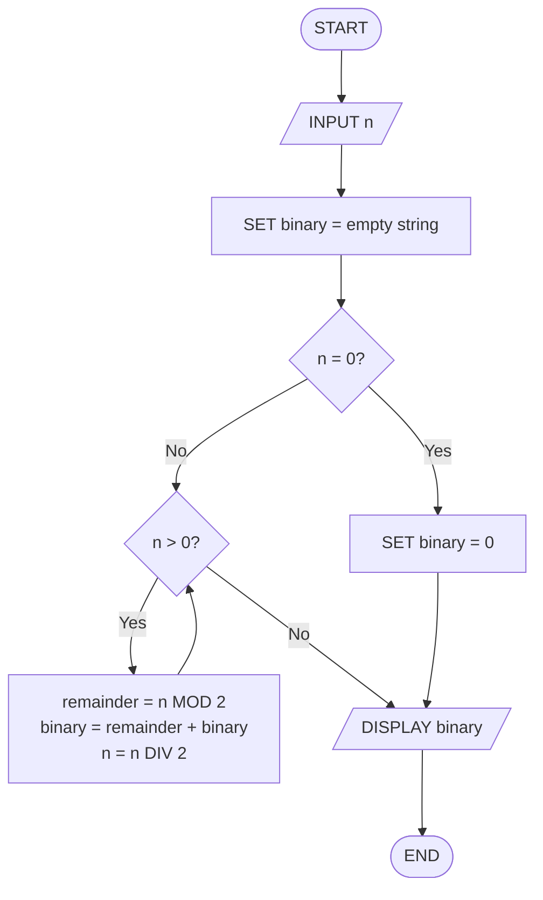
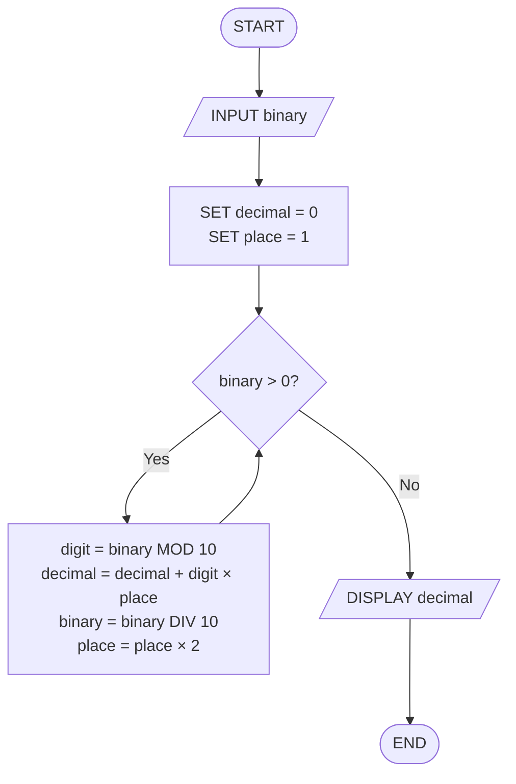

# CC 101 – Introduction to Computing

**Republic of the Philippines**
**Sorsogon State University**
**College of Information and Communications Technology – Bulan Campus**
Zone 8, Bulan, Sorsogon | Tel. No.: 056 311-0103 | Email: cict@sorsu.edu.ph

## "From Problem to README": Designing a Number-System Converter and Documenting It in Markdown

| | |
|---|---|
| **Name** | Julius B. Banalnal |
| **Block** | BSCS 1-1 |
| **Computer Unit Used (Desktop/Laptop, brand)** | ASUS Vivobook Go 15.6-inch FHD (AMD Ryzen 3 7320U, 8 GB RAM, 128 GB SSD) |
| **Date** | October 19, 2026 |

---

## I. Objectives

At the end of this activity, you should be able to:

- Analyze a number-system conversion problem by identifying its inputs, processes, loop condition, and outputs.
- Write pseudocode using sequence, selection, and iteration.
- Draw flowcharts using standard symbols and check them by tracing and testing with sample data.
- Create a properly formatted README.md file in Markdown using Notepad, without an Internet connection.
- Upload the README.md to your CC 101 GitHub Computing Portfolio repository (take-home part).

## II. Materials Needed

- A computer running Windows 11 with Notepad (no network or Internet connection is needed in the laboratory)
- This worksheet, a pencil, and a ruler (or a flowchart template) for drawing flowcharts
- A USB flash drive, to bring your README.md home for uploading
- For Part G only (outside the laboratory): any device with Internet access and a free GitHub account
- Week 7 lecture notes, for reference on pseudocode, flowchart symbols, and Markdown syntax

## III. Background

Programmers do not start by typing code. They first analyze the problem, plan the solution as pseudocode and a flowchart, and check it by hand. In this activity, you will design a program that converts numbers between the decimal and binary number systems you learned in Week 5. An algorithm can be written as pseudocode (English-like steps) or drawn as a flowchart (standard symbols connected by arrows). Good work is also documented. On GitHub, the standard way to introduce a project is a `README.md` file written in Markdown, a plain-text format that uses symbols such as `#`, `*`, and `-` for headings, emphasis, and lists. Because Markdown is plain text, you can write it in Notepad with no Internet connection and upload it to GitHub later.

## IV. Procedure

### Part A – Analyze the Problem (Problem 1)

**Problem 1: Decimal-to-Binary Converter.** Design a program that asks the user for a whole number in **decimal** (base 10) that is 0 or greater, converts it to **binary** (base 2), and displays the binary result.

**Worked example (13 in decimal):** 13 ÷ 2 = 6 r 1; 6 ÷ 2 = 3 r 0; 3 ÷ 2 = 1 r 1; 1 ÷ 2 = 0 r 1. Reading the remainders from bottom to top gives **1101**.

1. Convert 13 and 25 to binary by hand using the method above, so you understand every step before writing the pseudocode.
2. Complete **Table 1**: list the input, the output, the processes (operations), the decision or loop condition, and the variables you will need.

### Part B – Write the Pseudocode

3. In **Box 1**, write the pseudocode for Problem 1. Use `START`, `INPUT`, `SET`, `WHILE … DO … ENDWHILE`, `IF … THEN … ELSE … ENDIF`, `DISPLAY`, and `END`, and indent the steps inside the loop.

   > **Tip:** Use **MOD** for the remainder of a division (13 MOD 2 = 1) and **DIV** for whole-number division (13 DIV 2 = 6). Each new remainder must be placed at the **left** of the binary digits found so far, for example `SET binary = remainder + binary`. Also decide what your algorithm should display when the input is 0.

### Part C – Draw the Flowchart and Desk Check

4. In **Figure 1**, draw the flowchart for Problem 1 using the standard symbols: oval (start/end), parallelogram (input/output), rectangle (process), and diamond (decision). Show the loop with an arrow going back to the decision, and label every decision exit **Yes** or **No**.
5. Trace your pseudocode with the input **13** and fill in one row of **Table 2** for each pass through the loop. The last column should end with 1101.
6. Test your pseudocode and flowchart with the five inputs in **Table 3**. First convert each number by hand, then follow your pseudocode or flowchart step by step. If the two results do not match, find and correct the error in your pseudocode and flowchart.

### Part D – Reverse Conversion (Problem 2)

**Problem 2: Binary-to-Decimal Converter.** Design a program that asks the user for a binary number (entered as digits 0 and 1, such as 1101) and displays its decimal value. Use the **positional (place value) method** from Week 5: starting from the rightmost digit, multiply each digit by its place value (1, 2, 4, 8, 16, …) and add the products.

**Worked example (1101 in binary):** (1 × 1) + (0 × 2) + (1 × 4) + (1 × 8) = 1 + 0 + 4 + 8 = **13**.

7. In **Box 2**, write the pseudocode. You can take the rightmost digit with `binary MOD 10` and remove it with `binary DIV 10`; the place value starts at 1 and doubles after each digit.
8. In **Figure 2**, draw its flowchart.
9. Test your pseudocode with the inputs in **Table 4**, comparing hand computation with the result of following your pseudocode.
10. **Optional / Bonus:** Extend Problem 1 so the user can choose the target base (2, 8, or 16). For base 16, remainders 10 to 15 must be displayed as the letters A to F. Write the extended pseudocode in the Bonus box.

### Part E – Create Your README.md Offline

11. Show file extensions so that you can see the real file name. Press **Windows + E** to open File Explorer, then click **View → Show → File name extensions** (make sure it is checked).
12. In File Explorer, click **Documents**, then click **New → Folder**. Name the folder **cc101-portfolio** (all lowercase, with a hyphen) and press **Enter**. Open it and create two more folders inside: **week07-algorithms** and **images**.
13. Press the **Windows key**, type **Notepad**, and press **Enter**. If your Notepad shows a formatting toolbar, open the **View** menu and switch to the Markdown **syntax** view so the symbols you type stay visible.
14. Type the README content below. Replace everything in square brackets with your own information, and replace the pseudocode with your pseudocode from Box 1. Keep the blank lines; they separate the parts.

````markdown
# CC 101 Computing Portfolio

This repository contains my laboratory outputs and documentation for *CC 101 Introduction to Computing* at **Sorsogon State University – Bulan Campus**.

## About Me

- **Name:** Julius B. Banalnal
- **Program and Section:** BSCS 1-1
- **Interests:** Coding and programming, learning about computers, and solving problems
- **Goal:** My goal is to improve my programming skills and become a capable computing professional.

## Course Information

| Item | Details |
| --- | --- |
| Course | CC 101 Introduction to Computing |
| Instructor | Not provided in the worksheet |
| Academic Year | 2026–2027 |

## Portfolio Contents

1. [Week 7 – Pseudocode and Flowcharts](week07-algorithms/)
2. More activities will be added each week.

## Sample Pseudocode: Decimal to Binary

```
START
  INPUT n
  SET binary = ""
  IF n = 0 THEN
    SET binary = "0"
  ELSE
    WHILE n > 0 DO
      SET remainder = n MOD 2
      SET binary = remainder + binary
      SET n = n DIV 2
    ENDWHILE
  ENDIF
  DISPLAY binary
END
```

## My Workspace


---

*Last updated: 2026-10-19*
````

15. Save the file. Click **File → Save as**. Go to **Documents → cc101-portfolio**. Type **README.md** as the **File name**, set **Save as type** to **All files**, make sure **Encoding** is **UTF-8**, and click **Save**.
16. Verify the file. In File Explorer, open the cc101-portfolio folder and confirm the file is named **README.md**, not README.md.txt. If it ends in .txt, right-click it, choose **Rename**, and remove .txt. Then press the **Windows key**, type **cmd**, press **Enter**, and run the commands below. Record the results in **Table 5**.

    ```cmd
    cd %USERPROFILE%\Documents\cc101-portfolio
    dir
    type README.md
    ```

    *Tip: If "The system cannot find the path specified" appears, your Documents folder may be inside OneDrive. Try `cd %USERPROFILE%\OneDrive\Documents\cc101-portfolio` instead.*

17. Optional preview: if your Notepad has a formatted view, switch to it from the **View** menu and note in Table 5 which elements appear formatted. Some elements, such as tables, images, and code blocks, may still appear as plain text. GitHub will display them correctly.
18. Copy the whole **cc101-portfolio** folder to your USB flash drive.

### Part F – Peer Review

19. Exchange seats with a classmate. Open their README.md in Notepad and complete the checklist in **Table 6** for their file. Write your name as the reviewer and return the worksheet. Fix any missing element in your own file before leaving.

### Part G – Take-Home: Upload to GitHub

Do this part when you have Internet access (at home, on campus Wi-Fi, or on your phone's browser in desktop mode).

20. Go to **github.com** and click **Sign up**. Use an email you check regularly and choose a professional username, such as your name. Verify your email address.
21. Click the **+** button at the upper right and choose **New repository**. Type **cc101-portfolio** as the **Repository name**, choose **Public**, and leave **Add a README file** unchecked. Click **Create repository**.
22. On the setup page, click the link **uploading an existing file**. Drag your README.md (and your week07-algorithms folder, if it has files) onto the page.
23. Under **Commit changes**, type **Add initial README** as the message and click **Commit changes**.
24. Open your repository's main page and check that the README appears formatted. Copy the repository URL (for example, `https://github.com/username/cc101-portfolio`), record it in **Table 7**, and submit it through the LMS.

> **Note:** GitHub does not store empty folders. The link to `week07-algorithms` will work after that folder contains at least one file, and the image will appear after you upload `images/my-pc.jpg`.

---

## V. Data and Findings

### Table 1. Problem Analysis for Problem 1 (Part A)

| Item | Your Answer |
|---|---|
| Restated problem (your own words) | Ask the user for a whole decimal number that is 0 or greater, convert it to binary, and display the answer. |
| Input | A whole number n in decimal (base 10), where n ≥ 0. |
| Output | The binary representation of the input number. If the input is 0, display 0. |
| Processes (operations) | Use MOD 2 to get each remainder; use DIV 2 to reduce the number; place each new remainder at the left of the binary string. |
| Loop condition (when the loop stops) | Repeat while n > 0. Stop when n = 0. Handle input 0 separately so the output is 0. |
| Variables needed | n (number being converted), remainder (n MOD 2), binary (result string). |
| 13 and 25 in binary (computed by hand) | 13₁₀ = 1101₂; 25₁₀ = 11001₂. |

### Box 1. Pseudocode for Problem 1 (Part B)

```text
START
  INPUT n
  SET binary = ""
  IF n = 0 THEN
    SET binary = "0"
  ELSE
    WHILE n > 0 DO
      SET remainder = n MOD 2
      SET binary = remainder + binary
      SET n = n DIV 2
    ENDWHILE
  ENDIF
  DISPLAY binary
END
```

### Figure 1. Flowchart for Problem 1 (Part C)



### Table 2. Trace of Problem 1 with Input 13 (Part C)

| Pass | n (before) | n MOD 2 (remainder) | n DIV 2 (new n) | binary (so far) |
|---|---|---|---|---|
| 1 | 13 | 1 | 6 | 1 |
| 2 | 6 | 0 | 3 | 01 |
| 3 | 3 | 1 | 1 | 101 |
| 4 | 1 | 1 | 0 | 1101 |
| 5 | — | — | — | — (loop has stopped) |

Value displayed at the end: **1101**

### Table 3. Test Cases for Problem 1 (Part C)

| Case | Decimal Input | Binary (by hand) | Binary From Your Pseudocode | Match? (Y/N) |
|---|---|---|---|---|
| 1 | 0 | 0 | 0 | Y |
| 2 | 5 | 101 | 101 | Y |
| 3 | 13 | 1101 | 1101 | Y |
| 4 | 25 | 11001 | 11001 | Y |
| 5 | 255 | 11111111 | 11111111 | Y |

### Box 2. Pseudocode for Problem 2 (Part D)

```text
START
  INPUT binary
  SET decimal = 0
  SET place = 1
  WHILE binary > 0 DO
    SET digit = binary MOD 10
    SET decimal = decimal + (digit × place)
    SET binary = binary DIV 10
    SET place = place × 2
  ENDWHILE
  DISPLAY decimal
END
```

### Figure 2. Flowchart for Problem 2 (Part D)



### Table 4. Test Cases for Problem 2 (Part D)

| Case | Binary Input | Decimal (by hand) | Decimal From Your Pseudocode | Match? (Y/N) |
|---|---|---|---|---|
| 1 | 1101 | 13 | 13 | Y |
| 2 | 101010 | 42 | 42 | Y |
| 3 | 11111111 | 255 | 255 | Y |
| 4 | 10000000 | 128 | 128 | Y |

### Bonus Box. Extended Pseudocode: Decimal to Base 2, 8, or 16 (Optional)

```text
START
  INPUT n
  INPUT base
  IF base = 2 OR base = 8 OR base = 16 THEN
    SET result = ""
    IF n = 0 THEN
      SET result = "0"
    ELSE
      WHILE n > 0 DO
        SET remainder = n MOD base
        IF remainder < 10 THEN
          SET digit = remainder
        ELSE
          IF remainder = 10 THEN SET digit = "A"
          ELSE IF remainder = 11 THEN SET digit = "B"
          ELSE IF remainder = 12 THEN SET digit = "C"
          ELSE IF remainder = 13 THEN SET digit = "D"
          ELSE IF remainder = 14 THEN SET digit = "E"
          ELSE SET digit = "F"
          ENDIF
        ENDIF
        SET result = digit + result
        SET n = n DIV base
      ENDWHILE
    ENDIF
    DISPLAY result
  ELSE
    DISPLAY "Invalid base"
  ENDIF
END
```

### Table 5. README.md File Check (Part E)

| Item | Your Findings |
|---|---|
| Full folder path of cc101-portfolio | `C:\Users\[your Windows username]\Documents\cc101-portfolio` (use your actual Windows username; if Documents is in OneDrive, use `OneDrive\Documents`). |
| File name shown in File Explorer | README.md (confirm that it is not README.md.txt). |
| Type shown in File Explorer (Details view) | Markdown/source text file; verify the exact Type label on your computer. |
| Size of README.md shown by `dir` (bytes) | Record the exact byte size shown by `dir` after saving README.md. |
| Does `type README.md` show your Markdown text? (Y/N) | Y — after you create and save the README.md content below. |
| Notepad formatted view available? (Y/N) | Y |
| Elements that appeared formatted in Notepad (if available) | If Markdown formatted view is available: headings, bold/italic text, lists, and horizontal rule may be formatted; tables, links, images, and code blocks may remain plain text. |

### Table 6. Peer Review Checklist (Part F)

**Reviewer's name:** Sola, John Jeric  |  **Owner of the README:** Julius B. Banalnal

| Element | Markdown Used | Present and Correct? (Y/N) |
|---|---|---|
| Level-1 heading | `#` | Y |
| Level-2 headings | `##` | Y |
| Paragraph | Text with a blank line before and after | Y |
| Bold and italic text | `**bold**` `*italic*` | Y |
| Bulleted list | `- item` | Y |
| Numbered list | `1. item` | Y |
| Table | `\| --- \|` header separator | Y |
| Link | `[text](url)` | Y |
| Image | `` | Y |
| Code block | Lines between two lines of three backticks | Y |
| Horizontal rule | `---` | Y |
| File saved as README.md (not .txt) | Y | Y |

### Table 7. GitHub Submission (Part G, Take-Home)

| Item | Your Answer |
|---|---|
| GitHub username | 26128352 |
| Repository URL | https://github.com/25128352/GitHub-CC101-Introduction-to-Computing |
| Date uploaded (YYYY-MM-DD) | 2026-10-20 |
| Does the README display formatted on GitHub? (Y/N) | Complete after opening the repository page. |
| Elements that did not display as expected, and why | Complete after checking GitHub. The image will not appear until `images/my-pc.jpg` is uploaded; the `week07-algorithms` link needs a file in that folder. |

---

## VI. Realization (Reflection)

*In two to four sentences each, answer the following in your own words.*

**1. Which was easier for you to create, the pseudocode or the flowchart? Why?**

> For me, pseudocode was easier to create because I could write the steps using simple words. It helped me understand the process before drawing the flowchart. After making the pseudocode, it was easier to turn the steps into symbols and arrows.

**2. Did tracing and testing reveal any errors in your pseudocode or flowcharts? Describe what you found and how you corrected it.**

> Yes, tracing and testing helped me check if the steps were correct. I learned that the input 0 needs special handling in the decimal-to-binary converter because the loop would not run. I corrected this by adding a condition to display 0 when the input is 0.

**3. How is writing a README in Markdown different from typing a document in Microsoft Word?**

> Writing a README in Markdown is different because I use symbols like #, **, and - to format headings, bold text, and lists. In Microsoft Word, I can format text using buttons and menus. Markdown is also useful for GitHub because it can display the README in an organized way.

**4. How can a GitHub portfolio help you as a future computing professional?**

> A GitHub portfolio can help me keep my school activities, projects, and codes in one place. It can also help me show my skills and progress to other people, especially when I apply for internships or a job in the future.

---

## VII. Scoring Guide

| Criteria | Description | Points |
|---|---|---|
| Problem Analysis & Pseudocode | Table 1 is complete; the pseudocode for both conversions is correct (correct use of MOD, DIV, and the loop), uses proper keywords, and is indented. | 25 |
| Flowcharts & Testing | Both flowcharts use the correct symbols with labeled decisions and a clear loop; the trace (Table 2) and test cases (Tables 3 and 4) are correct. | 25 |
| README.md | The file is saved correctly as README.md, uses all required Markdown elements, and passes the peer review in Table 6. | 25 |
| GitHub Upload | The README is uploaded to a public cc101-portfolio repository and the URL is submitted (Table 7). | 10 |
| Realization / Reflection | Answers are thoughtful, specific to the student's own work, and well written. | 10 |
| Neatness & Timeliness | Worksheet is legible/well-formatted and submitted on time. | 5 |
| **Total** | | **100** |
